<div align="center">

# ShiftGuard

**Does conformal abstention survive site shift? A multi-site autism neuroimaging benchmark.**

*A model that says "I am 90% sure" must keep that promise at a hospital it has never seen.
This benchmark measures when it does not, and which corrections actually help.*

[](https://github.com/amarilokmane1-code/shiftguard/actions/workflows/ci.yml)
[](https://www.python.org/downloads/)
[](LICENSE)
[](docs/DATA_CARD.md)
[](docs/MODEL_CARD.md)

</div>

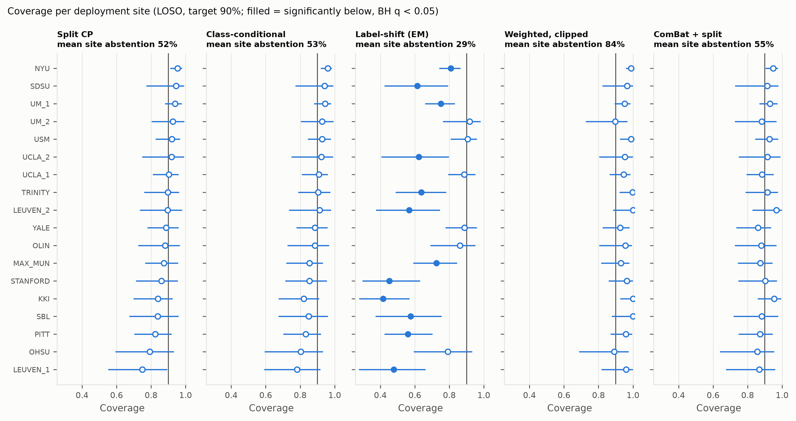

*Figure 3. Each row is one hospital the model never saw during training. A dot left of
the vertical line (90% target) means the promised coverage was not met there. Split
conformal prediction meets the target on average but not at every site; the standard
label-shift correction (middle) makes it worse; ComBat harmonisation (right) narrows the
spread. Bars: Clopper–Pearson 95% intervals; filled = significantly below target after
Benjamini–Hochberg.*

## TL;DR: key findings

- **Pooled numbers hide site-level failure.** At a 90% target, split conformal prediction
  covers **89.8%** of subjects pooled over 18 unseen sites, but only **75%** at the worst
  site and **55%** for one diagnostic group at one site.
- **The cause is site-specific miscalibration, mostly not a change in how many autistic
  participants a site has.** Sites over- and under-estimate autism in opposite directions
  (KKI +0.22, LEUVEN_1 −0.21), and these errors cancel in pooled numbers. Prevalence
  (label) shift explains only 33% of them.
- **Two textbook corrections fail.** Label-shift conformal prediction with an EM prior
  estimate drops to **72.9%** coverage. Covariate-shift weighting reaches its coverage
  only by abstaining on **86%** of subjects.
- **ComBat harmonisation is the best correction without labels**, but its gain is modest:
  worst site 75% → **85.6%**, worst site-class 55% → **79%**, and the gain in mean
  shortfall is not robust to a stricter (two-stage) bootstrap (q = 0.076). Twenty labelled
  subjects from the new site help more reliably (+3.3 coverage points, 95% CI
  [0.9, 5.9]), at the cost of more abstention.
- **Without any label, the *direction* of the failure is detectable but its *size* is
  not.** The shift in mean predicted P(ASD) predicts which diagnosis loses coverage
  (Spearman ρ = 0.83, q = 0.001, 18 sites). No label-free signal predicts how much
  coverage drops (all q ≥ 0.23), and a high abstention rate is not a warning sign.
- **Honest scope.** The classifier is weak (AUC 0.73), so more than half of subjects
  receive both labels. This is a research benchmark, **not a diagnostic tool**.

## Why this matters

Clinical AI models are usually trained on data from a few hospitals and then used at
others, with different scanners, protocols and patient populations. Conformal prediction
is a popular way to make such models "know when they don't know": instead of a single
answer, the model returns a set of possible answers that is guaranteed to contain the
truth, for example, 90% of the time, and it abstains when it is unsure. That guarantee
assumes the new hospital's data look like the calibration data. ShiftGuard tests what
happens when that assumption breaks, on real multi-site brain-imaging data, and reports
the failures as carefully as the successes. The practical lesson is to report
reliability **per site and per group, never only pooled**, and to budget a few labelled
cases at every new site. This is the pilot study for a PhD proposal on *abstention that
survives distribution shift* in autism research.

## Pipeline

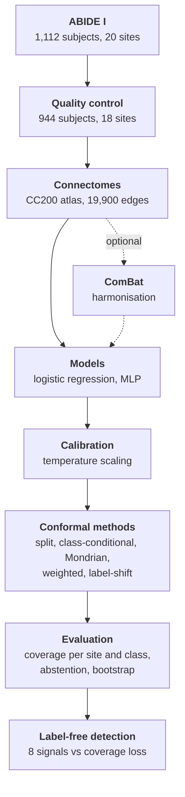

Every model is trained with **leave-one-site-out (LOSO)**: one site plays the new hospital
and is never used for training, calibration or tuning. The only exceptions are the
explicit few-labels arm (Mondrian), and ComBat and the domain classifier, which see that
site's **unlabelled** features. 10 seeds; the calibration split is halved (temperature
scaling / conformal quantile).

## Results

*The table below is generated by `shiftguard report` from
[conformal_headline.csv](reports/tables/conformal_headline.csv) and the baseline tables;
the runs it comes from are listed in [docs/RESULTS.md](docs/RESULTS.md).* L2 logistic
regression, LAC score, α = 0.1 (target coverage 0.90), 10 seeds. **Coverage gap** = mean
over sites of max(0, 0.90 − site coverage); **worst site-class** = lowest coverage within
one diagnosis at one site; **abstention** = the prediction set is not a single class;
**accuracy (kept)** = accuracy on the subjects that received a single label.

> **Provenance.** The final runs were made during development from working trees with
> uncommitted changes, as [docs/RESULTS.md](docs/RESULTS.md) states per run; a rerun of
> the full pipeline from a single clean commit is planned.

<!-- key-results:start -->
| Setting | Method | AUC | Balanced acc. | Marginal coverage | Worst-site coverage | Worst site-class | Coverage gap | Abstention | Accuracy (kept) |
|---|---|---|---|---|---|---|---|---|---|
| Within-site | Split CP | 0.732 | 0.668 | 0.911 | – | – | – | 0.593 | 0.791 |
| LOSO | Split CP | 0.731 | 0.672 | 0.898 | 0.750 | 0.550 | 0.031 | 0.554 | 0.771 |
| LOSO | Class-conditional CP | 0.731 | 0.672 | 0.901 | 0.782 | 0.607 | 0.030 | 0.564 | 0.773 |
| LOSO | Label-shift CP (EM prior) | 0.731 | 0.672 | 0.729 | 0.417 | 0.000 | 0.209 | 0.324 | 0.626 |
| LOSO | Weighted CP (covariate shift, clipped) | 0.731 | 0.672 | 0.964 | 0.892 | 0.869 | 0.001 | 0.858 | 0.752 |
| LOSO | ComBat + split CP | 0.749 | 0.684 | 0.910 | 0.856 | 0.793 | 0.014 | 0.564 | 0.793 |
| LOSO | ComBat + weighted CP (clipped) | 0.749 | 0.684 | 0.911 | 0.843 | 0.764 | 0.015 | 0.571 | 0.793 |
| LOSO | Mondrian (20 target labels) | 0.731 | 0.672 | 0.910 | 0.820 | 0.741 | 0.010 | 0.579 | 0.788 |

<!-- key-results:end -->

Mondrian is scored on the subjects outside its 20 labelled ones, as is the matching split
CP in the paired comparison. With 0 or 5 target labels it returns full sets (100%
abstention), because a group needs at least 9 points at α = 0.1.

**Why so much abstention?** A conformal predictor returns a single label only when the
model is confident enough to meet the coverage target. With AUC ≈ 0.73, most subjects sit
near the decision boundary. Asking for less coverage (α = 0.2) halves abstention, but it
does not remove the site failures:

| α (target) | Method | Marginal coverage | Worst-site coverage | Worst site-class | Abstention |
|---|---|---|---|---|---|
| 0.1 (0.90) | Split CP | 0.898 | 0.750 | 0.550 | 0.554 |
| 0.1 (0.90) | Class-conditional CP | 0.901 | 0.782 | 0.607 | 0.564 |
| 0.1 (0.90) | ComBat + split CP | 0.910 | 0.856 | 0.793 | 0.564 |
| 0.2 (0.80) | Split CP | 0.798 | 0.636 | 0.357 | 0.277 |
| 0.2 (0.80) | Class-conditional CP | 0.800 | 0.646 | 0.357 | 0.285 |
| 0.2 (0.80) | ComBat + split CP | 0.804 | 0.684 | 0.607 | 0.264 |

### Figure gallery

All figures are regenerated from the saved runs by `shiftguard report`
(PNG and PDF in [reports/figures/](reports/figures/)).

| | |
|---|---|
| **Figure 1. The cohort.** 944 of 1,112 subjects pass quality control; look at how unequal the sites are (25 to 172 subjects), which limits per-site power. | **Figure 2. The site effect.** Before ComBat the scanning site can be read from the connectome (balanced accuracy 0.55, chance 0.06); after ComBat it cannot (0.05). |
| 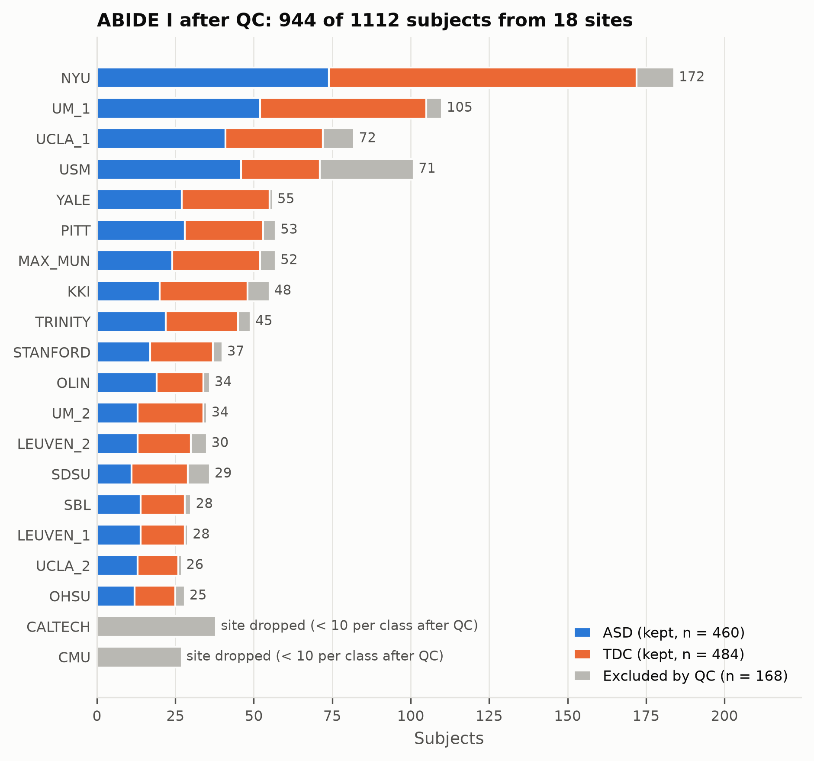 | 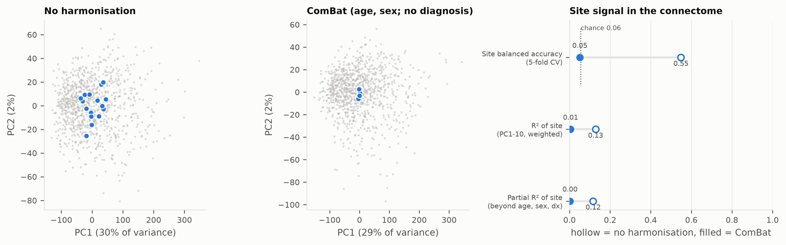 |
| **Figure 3b. Coverage per diagnosis and site.** Look for the blue (ASD) and orange (TDC) markers on opposite sides of the 90% line: the class that loses coverage changes from site to site. | **Figure 4. Labels vs abstention.** Left: Mondrian needs about 10–20 labelled target subjects before it returns informative sets. Right: every method's worst-site coverage against its abstention rate; methods that protect the worst site better tend to abstain more. |
| 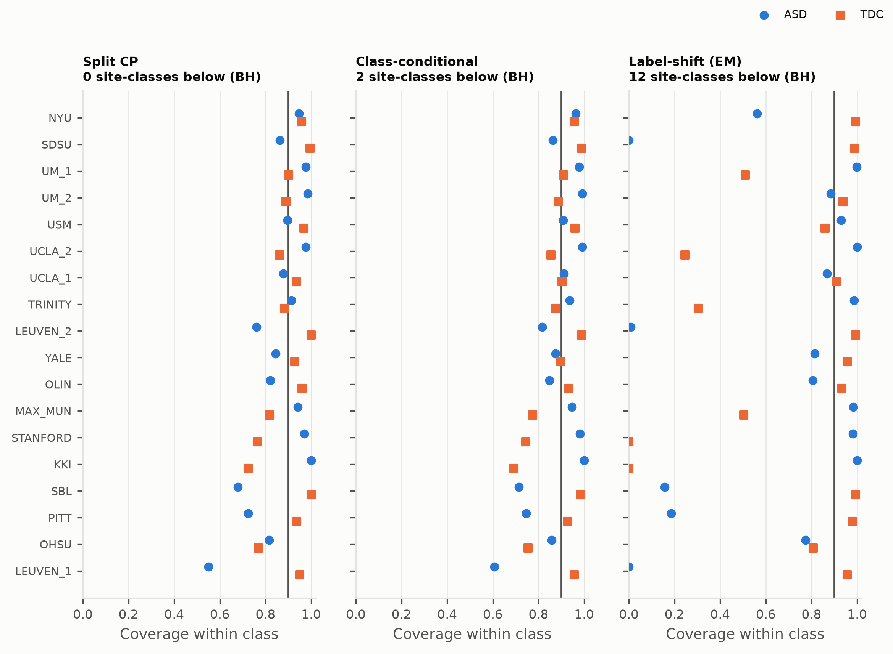 | 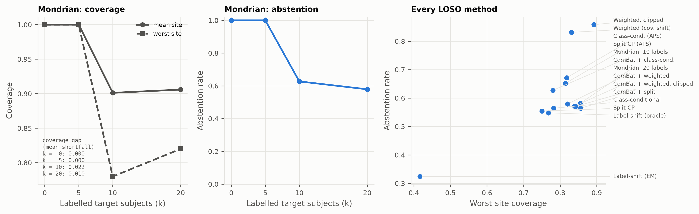 |
| **Figure 5. Abstention per site.** Grey bars are abstention, dots are accuracy on the subjects that got a single label; covariate-shift weighting (third panel) abstains on almost everyone. | **Figure 6. Calibration.** Pooled curves look well calibrated, but the right column shows per-site offsets (KKI, LEUVEN_1, USM, PITT) outside the grey range expected without shift. |
| 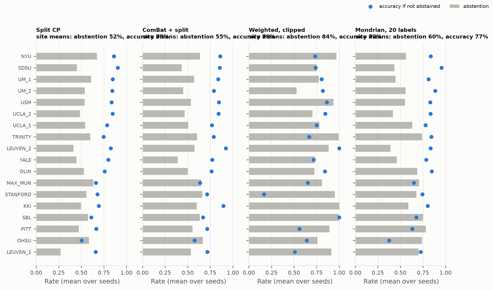 | 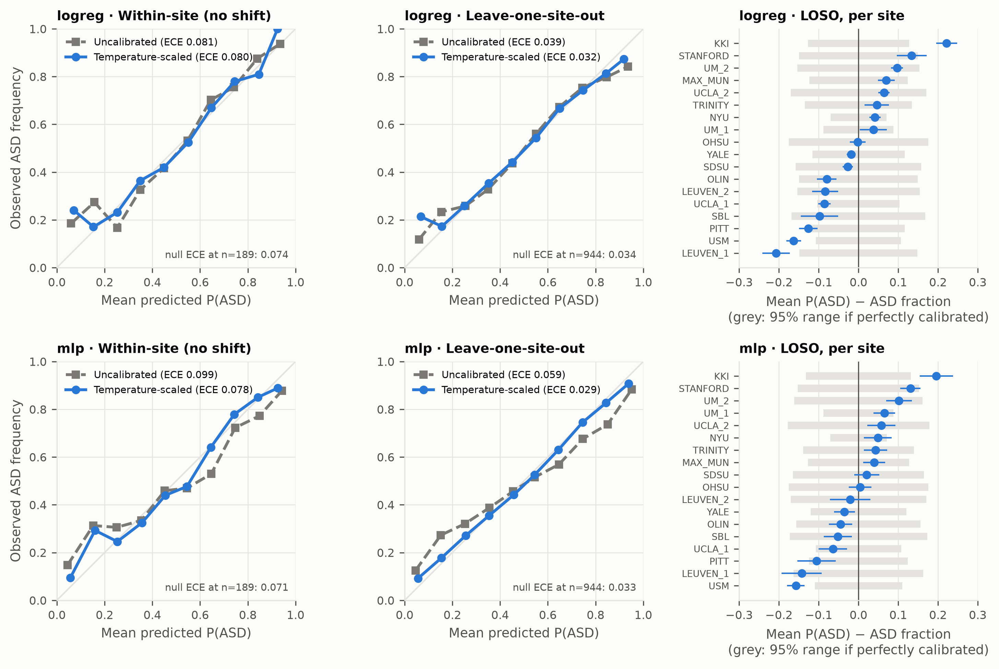 |
| **Figure 7. Label-free signals vs coverage drop.** No panel shows a reliable trend: none of the eight signals predicts how much coverage a site loses. | **Figure 7b. Which class loses coverage.** A clear diagonal: the sign of the mean P(ASD) shift tells which diagnosis will be under-covered (ρ = 0.83). |
| 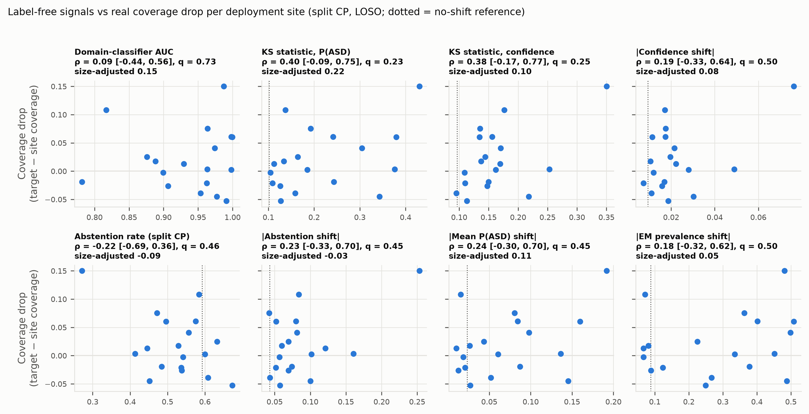 | 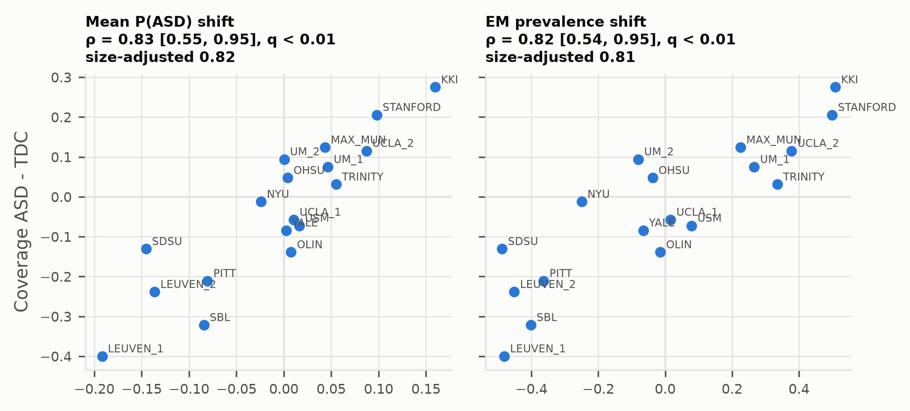 |
| **Figure S1. Is it label shift?** Left: the EM prevalence estimate does not track the true ASD fraction. Right: most offsets lie far from the dotted line that pure label shift would produce. | |
| 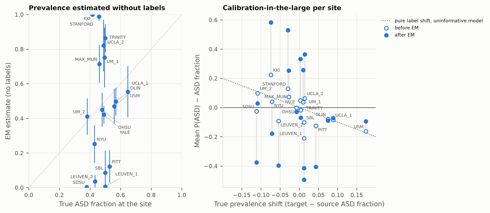 | |

<details>
<summary><b>Detailed findings by phase</b> (statistics, effect sizes, negative results)</summary>

#### Baselines and calibration

944 subjects, 18 sites, CC200 correlation connectomes (19,900 edges), mean ± SD over 10
seeds ([baselines](reports/tables/baselines.md)).

| Protocol | Model | AUC | Worst-site AUC | Balanced acc. | ECE (calibrated) | Null ECE at same n |
|---|---|---|---|---|---|---|
| Within-site | L2 logistic regression | 0.732 ± 0.030 | – | 0.668 ± 0.022 | 0.080 ± 0.017 | 0.074 |
| Within-site | MLP | 0.692 ± 0.030 | – | 0.620 ± 0.031 | 0.078 ± 0.021 | 0.071 |
| LOSO | L2 logistic regression | 0.731 ± 0.008 | 0.528 ± 0.043 | 0.672 ± 0.010 | 0.032 ± 0.006 | 0.034 |
| LOSO | MLP | 0.690 ± 0.014 | 0.468 ± 0.061 | 0.628 ± 0.018 | 0.029 ± 0.008 | 0.033 |

Pooled over sites, leaving a site out costs almost nothing: logistic-regression AUC is
0.731 under LOSO vs 0.732 within-site. The shift shows up **per site**: AUC ranges from
0.53 (OHSU) to 0.84 (USM), and at 4 of 18 deployment sites the mean predicted ASD
probability is off from the observed ASD fraction by more than chance (KKI +0.22,
LEUVEN_1 −0.21). These offsets cancel in the pooled curve.

#### Conformal prediction under site shift

Per-site and per-class tests use exact binomial tests with Clopper–Pearson intervals and
Benjamini–Hochberg (BH) correction. Method differences use a paired bootstrap over sites
(2000 resamples); a two-stage bootstrap that also resamples subjects within sites is a
sensitivity analysis ([comparisons](reports/tables/conformal_comparisons.md)).

1. **Split CP holds on average but not per site or per class.** No single site is
   significantly below 90% after BH (25–172 subjects per site, so power is low). Still,
   11 of 18 sites are below target, the empirical-Bayes between-site SD of true coverage
   is 0.030, and within-class coverage reaches 0.55 (ASD at LEUVEN_1).
2. **The shift is mostly *not* a prior (label) shift.** The true ASD fraction at KKI,
   LEUVEN_1 and PITT is within 0.08 of the training sites, yet their calibration offsets
   (+0.22, −0.21, −0.13) are about 4, 21 and 4 times what a prior shift of that size can
   produce. Pure label shift accounts for 33% of the summed squared offsets, and the
   offsets exceed its bound by more than 2 SD at 5 sites. **USM is the one clear prior
   shift** (ASD fraction 0.65 vs 0.47; offset −0.16, predicted −0.15)
   ([prevalence shift](reports/tables/prevalence_shift.md)).
3. **Label-shift correction fails (negative result).** The EM prior estimate (Saerens et
   al., 2002) does not track the true ASD fraction (ρ = 0.11 across sites); it runs to
   within 0.05 of 0 or 1 at 5 of 18 sites. Label-shift CP with EM priors falls to 0.729
   coverage (−0.188 vs split CP, 95% CI [−0.257, −0.121]). With the *true* prior (an
   oracle that uses target labels), it equals split CP.
4. **Class-conditional CP does not rescue per-class coverage.** Its per-class guarantee
   holds under pure label shift only. KKI controls (0.69) and LEUVEN_1 ASD (0.61) remain
   significantly below target.
5. **ComBat is the best label-free correction here.** Fitted on the training sites plus
   the unlabelled deployment site (age and sex preserved, no diagnosis), it removes the
   site signal. ComBat + split CP raises the worst site from 0.750 to 0.856 and the worst
   site-class from 0.55 to 0.79. Mean shortfall changes by −0.017 [−0.035, −0.002]
   (q = 0.045) with the site bootstrap, but by [−0.038, +0.000] (q = 0.076) with the
   two-stage bootstrap: the gain is modest and not robust. Covariate-shift weights on top
   change nothing.
6. **A few target labels help, at a price.** Mondrian CP with 20 labelled deployment
   subjects adds +0.033 coverage [0.009, 0.059] and +0.091 abstention.
7. **Covariate-shift weighting degenerates.** A domain classifier separates every
   deployment site from the training sites (AUC 0.78–1.00); the weights leave an
   effective sample size of 3.7–35 calibration points, so the sets are nearly full
   (abstention 0.86). Its coverage comes from abstaining, not from correcting the shift.
8. **Robustness.** The MLP, α = 0.2, and ROI-level instead of subject-level exclusion
   (979 subjects, 19 sites; split CP 0.895, worst site again LEUVEN_1) leave the
   conclusions unchanged.

#### Label-free shift detection (exploratory)

Eight signals are computed from the new site's features and predictions only:
domain-classifier AUC, KS tests on P(ASD) and on confidence, confidence shift,
abstention rate and its shift, mean P(ASD) shift, and EM prevalence shift. A unit test
checks that permuting the site's labels leaves every signal unchanged. Across 18 sites,
each signal is related to the real coverage loss with Spearman ρ, a site-bootstrap CI, a
permutation p-value, BH, the range over leave-one-site-out and a size-adjusted partial ρ
([correlations](reports/tables/detection_correlations.md)).

1. **No signal predicts how much marginal coverage drops (negative result):** ρ from
   −0.22 to 0.40, every q ≥ 0.23, also with the MLP and after ComBat.
2. **How strongly a site is shifted is not the issue.** Every site is shifted (domain AUC
   0.78–1.00), but domain AUC is unrelated to the coverage drop (ρ = 0.09).
3. **Abstention is not an alarm.** Sites where coverage drops abstain, if anything, *less*
   (ρ = −0.22): a model that is confidently wrong abstains less.
4. **The direction is detectable.** The signed mean P(ASD) shift predicts *which class*
   loses coverage: ρ = 0.83 [0.55, 0.95], q = 0.001; size-adjusted 0.82; 0.79 to 0.88
   across leave-one-site-out; 0.86 with the MLP. The EM prevalence shift carries the same
   information (ρ = 0.82). *Caveat:* this signal was added after the labelled version of
   the relation had been seen on the same sites, so it is a confirmation on the same
   data, not an independent test.
5. **Worst-class drop: not claimed.** KS on P(ASD) correlates with the worst-class drop
   (ρ = 0.67, q = 0.019) but not after adjustment for site size (ρ = 0.53, q = 0.14).

</details>

## Methods in brief

- **Data.** ABIDE I, Preprocessed Connectomes Project (C-PAC, band-pass filtered, no
  global signal regression), CC200 atlas; per-subject Pearson correlations, Fisher z,
  upper triangle. Subjects with failed rater QC or constant ROIs are excluded; sites with fewer
  than 10 subjects per class after QC are dropped.
- **Models.** L2 logistic regression (primary), tuned by nested cross-validation on the
  training sites only, and a small fixed-architecture MLP with early stopping; both are
  temperature-scaled on half of the calibration split.
- **Conformal prediction.** LAC score (primary) and randomized APS; split,
  class-conditional, Mondrian with k ∈ {0, 5, 10, 20} labelled target subjects,
  covariate-shift weighted (domain-classifier likelihood ratios, plain and clipped),
  label-shift weighted (EM prior and oracle prior), and each of these after ComBat.
- **Statistics.** Exact binomial tests with Clopper–Pearson intervals and BH correction
  per site and class; paired site bootstrap for method differences (primary) and a
  two-stage site-then-subject bootstrap (sensitivity); beta-binomial empirical Bayes for
  the between-site spread.
- **Leakage controls.** Unit tests check that the deployment site never enters training,
  calibration or tuning, that ComBat and the label-free signals do not change when the
  site's labels are permuted, and that every split is identical across methods.

Full details: [docs/METHODS.md](docs/METHODS.md) · all tables and provenance:
[docs/RESULTS.md](docs/RESULTS.md) · [model card](docs/MODEL_CARD.md) ·
[data card](docs/DATA_CARD.md).

## Limitations

See [docs/LIMITATIONS.md](docs/LIMITATIONS.md) for all 13 points. The most important:

- **Weak classifier.** ASD classification from ABIDE connectomes is modest (AUC 0.73),
  here as in the literature, so abstention is high.
- **Sites differ in more than the scanner:** age, protocol and diagnostic practice
  differ too, so "site shift" mixes several kinds of shift.
- **Low per-site power.** 25–172 subjects per site; single-site statements rest on
  pooled statistics across sites.
- **ComBat is transductive:** it needs the new site's unlabelled data as a batch.
- **Detection is exploratory:** 18 sites, and the positive result has not been
  replicated on an independent cohort.
- **This is research software. It is not a diagnostic tool.**

## Reproduce in 3 commands

```bash
pip install -e ".[torch,harmonize]"
shiftguard all --config configs/experiment/loso.yaml --sensitivity
shiftguard report
```

`all` downloads ABIDE (about 0.4 GB, never committed), runs every analysis and writes
`reports/final_runs.yaml`; `report` rebuilds every table and figure from those runs and
writes `docs/RESULTS.md` and the table above. The full pipeline takes several hours on a
laptop CPU (per-step times are in the Kaggle notebook). On a CPU-only machine, install
PyTorch from the CPU index first, so pip does not fetch the much larger CUDA build:

```bash
pip install torch --index-url https://download.pytorch.org/whl/cpu
```

**Kaggle.** [`notebooks/kaggle_shiftguard.ipynb`](notebooks/kaggle_shiftguard.ipynb) runs
the same pipeline on a free Kaggle CPU session (Internet ON). To open it: Kaggle →
*Create → New Notebook → File → Import Notebook → GitHub*, then paste
`amarilokmane1-code/shiftguard` and pick `notebooks/kaggle_shiftguard.ipynb`.

**Development** (lint, tests, pre-commit; CI never downloads ABIDE):

```bash
pip install -e ".[torch,dev,harmonize]"
python tasks.py lint
python tasks.py test
```

## Project structure

```
shiftguard/
├── src/shiftguard/
│   ├── cli.py           # `shiftguard` command: download, features, run, conformal, detect, report, all
│   ├── data/            # ABIDE download, phenotypes, QC, time series, synthetic data
│   ├── features/        # connectomes, ComBat harmonisation
│   ├── models/          # logistic regression, MLP, temperature scaling
│   ├── conformal/       # scores, quantiles, split, Mondrian, weighted, label-shift
│   ├── shift/           # domain classifier, likelihood-ratio weights, EM prior
│   ├── evaluation/      # LOSO runner, conformal summary, statistics, detection, report
│   ├── viz/             # one colour-blind-safe style for every figure
│   └── utils/           # config, seeding, provenance, logging, tables
├── configs/             # YAML: data, model, conformal, experiment
├── tests/               # unit, leakage, statistics and end-to-end tests
├── notebooks/           # Kaggle notebook and its generator
├── reports/
│   ├── figures/         # generated PNG + PDF figures (tracked)
│   ├── tables/          # generated CSV + Markdown tables (tracked)
│   └── final_runs.yaml  # which run folders the results come from
└── docs/                # METHODS, RESULTS, LIMITATIONS, MODEL_CARD, DATA_CARD
```

## Data

ABIDE I Preprocessed (Preprocessed Connectomes Project). The data are downloaded by the
code, **never committed**, and subject to their own terms of use; see
[docs/DATA_CARD.md](docs/DATA_CARD.md).

## Citation

If you use ShiftGuard, please cite it via [CITATION.cff](CITATION.cff) (GitHub's
*Cite this repository* button), or:

```bibtex
@software{amari_shiftguard,
  author  = {Amari, Lokmane},
  title   = {ShiftGuard: Does conformal abstention survive site shift?
             A multi-site autism neuroimaging benchmark},
  version = {0.1.0},
  license = {MIT},
  url     = {https://github.com/amarilokmane1-code/shiftguard}
}
```

## Author

**Lokmane Amari**
· ORCID [0009-0006-2358-5912](https://orcid.org/0009-0006-2358-5912)
· [LinkedIn](https://www.linkedin.com/in/amari-lokmane-4098913a9)

Related work:

> Amari L., Boukhiar N., Aissiou I., Bensefia Y. "Immun-AI: A Leakage-Safe, Explainable
> Multimodal Decision-Support Platform for Systemic Lupus Erythematosus Diagnosis."
> MICAD 2026, Springer Lecture Notes in Electrical Engineering (proceedings forthcoming).
