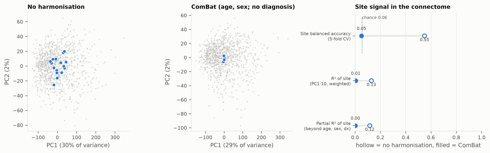
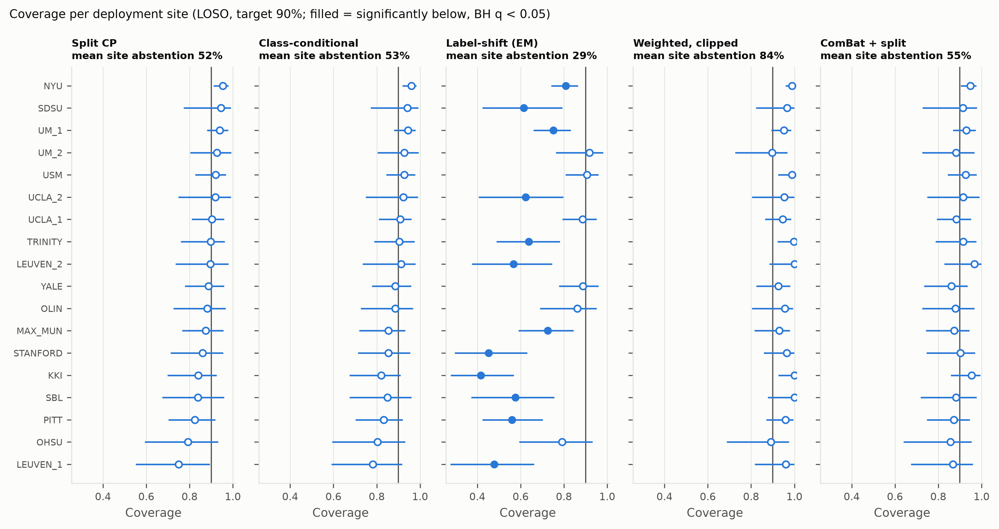
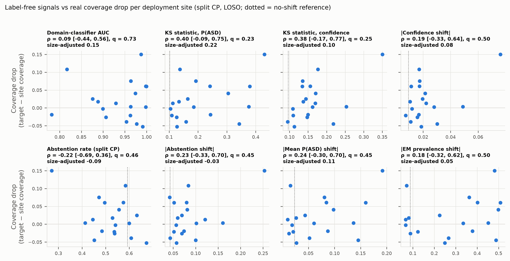
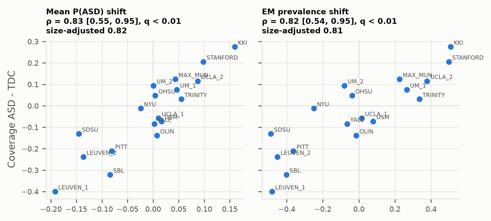

# Results

*Generated by `shiftguard report` from the CSV tables in `reports/tables/`, which come from the run folders listed below. Do not edit by hand; edit the code and rerun.*

**Research software. Nothing here supports clinical use.** Primary model: L2 logistic regression; primary score: LAC; α = 0.1 (target coverage 0.90) unless stated; 10 seeds; LOSO = leave one site out.

## Provenance

| analysis | run folder | git commit | uncommitted changes |
|---|---|---|---|
| simulate | 2026-11-01_175354_simulate | 75cbfc7 | yes |
| baseline | 2026-11-01_223647_loso | 960035b | yes |
| baseline_combat | 2026-11-02_101130_loso_combat | b8f8469 | yes |
| baseline_droprois | 2026-11-02_105846_loso_droprois | b8f8469 | yes |
| conformal | 2026-11-02_155103_conformal | c79e00a | yes |
| conformal_alpha0p2 | 2026-11-02_155702_conformal | c79e00a | yes |
| conformal_droprois | 2026-11-02_155801_conformal | c79e00a | yes |
| site_effect | 2026-11-02_155829_site_effect | c79e00a | yes |
| detection | 2026-11-02_155331_detection | c79e00a | yes |

*Uncommitted changes* means code, configs or docs differed from the commit when the run started. Tables and figures under `reports/` rewritten by an earlier step of the same pipeline are outputs and do not count.

Runs marked *uncommitted changes* were made from a working tree with edits not yet committed (development of that phase); the code that produced them was committed at the end of the phase.

## Cohort

ABIDE I (PCP, CPAC, filt_noglobal, CC200) after QC: **944 subjects** from **18 sites** (48.7% ASD, 85.1% male; 25–172 subjects per site). Per site: [cohort_summary.md](../reports/tables/cohort_summary.md); QC: [qc_summary.md](../reports/qc_summary.md).

## Baselines (phase 4)

Mean ± SD over seeds. ECE after temperature scaling, next to the ECE a perfectly calibrated model would show at the same size (null).

| protocol | model | auc | auc_site_worst | balanced_accuracy | ece_cal | ece_null | brier |
|---|---|---|---|---|---|---|---|
| loso | logreg | 0.731 ± 0.008 | 0.528 ± 0.043 | 0.672 ± 0.010 | 0.032 ± 0.006 | 0.034 ± 0.000 | 0.210 ± 0.003 |
| loso | mlp | 0.690 ± 0.014 | 0.468 ± 0.061 | 0.628 ± 0.018 | 0.029 ± 0.008 | 0.033 ± 0.001 | 0.221 ± 0.004 |
| within_site | logreg | 0.732 ± 0.030 | - | 0.668 ± 0.022 | 0.080 ± 0.017 | 0.074 ± 0.002 | 0.211 ± 0.010 |
| within_site | mlp | 0.692 ± 0.030 | - | 0.620 ± 0.031 | 0.078 ± 0.021 | 0.071 ± 0.003 | 0.222 ± 0.009 |

## Site effect before / after ComBat (Figure 2)

Site predictability from the connectome (5-fold CV balanced accuracy) and R² of site on the 10 leading principal components (variance-weighted; partial = beyond age, sex and diagnosis).

| harmonization | n_subjects | n_sites | site_balanced_accuracy | chance | r2_site | r2_site_partial |
|---|---|---|---|---|---|---|
| none | 944 | 18 | 0.549 | 0.056 | 0.129 | 0.116 |
| combat | 944 | 18 | 0.051 | 0.056 | 0.005 | 0.002 |

## Conformal prediction under site shift (phase 5)

Coverage pooled over sites (mean over seeds); site metrics on seed-averaged site coverage; `n_*_under` = number of sites (site-classes) significantly below target (exact binomial test, Benjamini–Hochberg q < 0.05); `between_site_sd` = empirical-Bayes SD of true site coverage.

| protocol | model | method | coverage | coverage_asd | coverage_tdc | worst_site_coverage | worst_site | worst_site_class_coverage | coverage_gap | n_sites_under | n_site_classes_under | abstention | selective_accuracy | between_site_sd |
|---|---|---|---|---|---|---|---|---|---|---|---|---|---|---|
| loso | logreg | class_conditional | 0.901 | 0.906 | 0.896 | 0.782 | LEUVEN_1 | 0.607 | 0.030 | 0.000 | 2.000 | 0.564 | 0.773 | 0.033 |
| loso | logreg | class_conditional_aps | 0.903 | 0.904 | 0.903 | 0.818 | LEUVEN_1 | 0.679 | 0.018 | 0.000 | 0.000 | 0.671 | 0.710 | 0.002 |
| loso | logreg | combat+class_conditional | 0.915 | 0.916 | 0.915 | 0.856 | UM_2 | 0.771 | 0.012 | 0.000 | 0.000 | 0.582 | 0.798 | 0.001 |
| loso | logreg | combat+split | 0.910 | 0.898 | 0.921 | 0.856 | OHSU | 0.793 | 0.014 | 0.000 | 0.000 | 0.564 | 0.793 | 0.011 |
| loso | logreg | combat+weighted | 0.911 | 0.897 | 0.924 | 0.839 | LEUVEN_1 | 0.757 | 0.015 | 0.000 | 0.000 | 0.571 | 0.793 | 0.008 |
| loso | logreg | combat+weighted_clip | 0.911 | 0.898 | 0.923 | 0.843 | LEUVEN_1 | 0.764 | 0.015 | 0.000 | 0.000 | 0.571 | 0.793 | 0.008 |
| loso | logreg | label_shift_em | 0.729 | 0.723 | 0.735 | 0.417 | KKI | 0.000 | 0.209 | 12.000 | 12.000 | 0.324 | 0.626 | 0.145 |
| loso | logreg | label_shift_oracle | 0.902 | 0.883 | 0.919 | 0.768 | LEUVEN_1 | 0.586 | 0.030 | 0.000 | 2.000 | 0.548 | 0.782 | 0.021 |
| loso | logreg | mondrian_k0 | 1.000 | 1.000 | 1.000 | 1.000 | KKI | 1.000 | 0.000 | 0.000 | 0.000 | 1.000 | - | 0.000 |
| loso | logreg | mondrian_k10 | 0.914 | 0.915 | 0.913 | 0.780 | OHSU | 0.643 | 0.022 | 0.000 | 0.000 | 0.627 | 0.782 | 0.027 |
| loso | logreg | mondrian_k20 | 0.910 | 0.904 | 0.915 | 0.820 | OHSU | 0.741 | 0.010 | 0.000 | 0.000 | 0.579 | 0.788 | 0.002 |
| loso | logreg | mondrian_k5 | 1.000 | 1.000 | 1.000 | 1.000 | KKI | 1.000 | 0.000 | 0.000 | 0.000 | 1.000 | - | 0.000 |
| loso | logreg | split | 0.898 | 0.887 | 0.908 | 0.750 | LEUVEN_1 | 0.550 | 0.031 | 0.000 | 0.000 | 0.554 | 0.771 | 0.030 |
| loso | logreg | split_aps | 0.898 | 0.890 | 0.906 | 0.814 | LEUVEN_1 | 0.664 | 0.020 | 0.000 | 0.000 | 0.652 | 0.710 | 0.002 |
| loso | logreg | split_aps_det | 1.000 | 1.000 | 1.000 | 1.000 | KKI | 1.000 | 0.000 | 0.000 | 0.000 | 1.000 | - | 0.000 |
| loso | logreg | weighted | 0.939 | 0.937 | 0.940 | 0.831 | UM_1 | 0.781 | 0.008 | 0.000 | 0.000 | 0.831 | 0.733 | 0.047 |
| loso | logreg | weighted_clip | 0.964 | 0.963 | 0.965 | 0.892 | OHSU | 0.869 | 0.001 | 0.000 | 0.000 | 0.858 | 0.752 | 0.019 |
| loso | mlp | class_conditional | 0.905 | 0.908 | 0.901 | 0.744 | OHSU | 0.657 | 0.024 | 0.000 | 0.000 | 0.618 | 0.751 | 0.020 |
| loso | mlp | class_conditional_aps | 0.895 | 0.901 | 0.890 | 0.796 | OHSU | 0.771 | 0.017 | 0.000 | 0.000 | 0.683 | 0.680 | 0.003 |
| loso | mlp | label_shift_em | 0.668 | 0.690 | 0.647 | 0.412 | KKI | 0.000 | 0.256 | 18.000 | 19.000 | 0.285 | 0.582 | 0.092 |
| loso | mlp | label_shift_oracle | 0.908 | 0.895 | 0.921 | 0.740 | OHSU | 0.536 | 0.024 | 0.000 | 0.000 | 0.616 | 0.762 | 0.011 |
| loso | mlp | mondrian_k0 | 1.000 | 1.000 | 1.000 | 1.000 | KKI | 1.000 | 0.000 | 0.000 | 0.000 | 1.000 | - | 0.000 |
| loso | mlp | mondrian_k10 | 0.916 | 0.918 | 0.914 | 0.847 | STANFORD | 0.762 | 0.006 | 0.000 | 0.000 | 0.656 | 0.760 | 0.001 |
| loso | mlp | mondrian_k20 | 0.896 | 0.898 | 0.895 | 0.838 | SBL | 0.676 | 0.013 | 0.000 | 0.000 | 0.592 | 0.746 | 0.002 |
| loso | mlp | mondrian_k5 | 1.000 | 1.000 | 1.000 | 1.000 | KKI | 1.000 | 0.000 | 0.000 | 0.000 | 1.000 | - | 0.000 |
| loso | mlp | split | 0.902 | 0.896 | 0.908 | 0.740 | OHSU | 0.636 | 0.023 | 0.000 | 0.000 | 0.611 | 0.749 | 0.007 |
| loso | mlp | split_aps | 0.894 | 0.896 | 0.893 | 0.796 | OHSU | 0.760 | 0.019 | 0.000 | 0.000 | 0.675 | 0.679 | 0.001 |
| loso | mlp | split_aps_det | 1.000 | 1.000 | 1.000 | 1.000 | KKI | 1.000 | 0.000 | 0.000 | 0.000 | 1.000 | - | 0.000 |
| loso | mlp | weighted | 0.939 | 0.940 | 0.938 | 0.820 | OHSU | 0.808 | 0.010 | 0.000 | 0.000 | 0.833 | 0.725 | 0.042 |
| loso | mlp | weighted_clip | 0.961 | 0.962 | 0.961 | 0.844 | OHSU | 0.825 | 0.003 | 0.000 | 0.000 | 0.860 | 0.737 | 0.019 |
| within_site | logreg | class_conditional | 0.910 | 0.900 | 0.919 | - | - | - | - | - | - | 0.613 | 0.781 | - |
| within_site | logreg | class_conditional_aps | 0.914 | 0.920 | 0.908 | - | - | - | - | - | - | 0.689 | 0.726 | - |
| within_site | logreg | split | 0.911 | 0.885 | 0.935 | - | - | - | - | - | - | 0.593 | 0.791 | - |
| within_site | logreg | split_aps | 0.905 | 0.887 | 0.922 | - | - | - | - | - | - | 0.670 | 0.716 | - |
| within_site | logreg | split_aps_det | 1.000 | 1.000 | 1.000 | - | - | - | - | - | - | 1.000 | - | - |
| within_site | mlp | class_conditional | 0.915 | 0.901 | 0.927 | - | - | - | - | - | - | 0.648 | 0.763 | - |
| within_site | mlp | class_conditional_aps | 0.897 | 0.884 | 0.908 | - | - | - | - | - | - | 0.690 | 0.692 | - |
| within_site | mlp | split | 0.915 | 0.903 | 0.926 | - | - | - | - | - | - | 0.649 | 0.765 | - |
| within_site | mlp | split_aps | 0.905 | 0.907 | 0.903 | - | - | - | - | - | - | 0.706 | 0.686 | - |
| within_site | mlp | split_aps_det | 1.000 | 1.000 | 1.000 | - | - | - | - | - | - | 1.000 | - | - |

Per-class coverage: [Figure 3b](../reports/figures/fig3b_class_coverage.png); labelled target subjects: [Figure 4](../reports/figures/fig4_target_labels.png); abstention per site: [Figure 5](../reports/figures/fig5_abstention_per_site.png); per site and class with Clopper–Pearson intervals: [conformal_sites.md](../reports/tables/conformal_sites.md).

### Each method minus split CP (logistic regression, LOSO)

Primary: paired bootstrap over sites (2000 resamples), 95% percentile CI, BH within model. Secondary: two-stage bootstrap (sites, then subjects within each drawn site). Shortfall = mean over sites of max(0, 0.90 − coverage).

| method | metric | difference (site bootstrap) | q | two-stage 95% CI | q (two-stage) |
|---|---|---|---|---|---|
| class_conditional | coverage | +0.004 [-0.002, +0.009] | 0.221 | [-0.004, +0.011] | 0.356 |
| class_conditional | shortfall | -0.001 [-0.007, +0.004] | 0.671 | [-0.009, +0.004] | 0.539 |
| class_conditional | abstention | +0.008 [-0.001, +0.017] | 0.097 | [-0.003, +0.020] | 0.205 |
| class_conditional_aps | coverage | +0.013 [+0.001, +0.026] | 0.045 | [-0.004, +0.032] | 0.151 |
| class_conditional_aps | shortfall | -0.013 [-0.024, -0.004] | 0.012 | [-0.031, -0.003] | 0.041 |
| class_conditional_aps | abstention | +0.127 [+0.102, +0.154] | 0.000 | [+0.092, +0.162] | 0.000 |
| combat+class_conditional | coverage | +0.026 [+0.005, +0.048] | 0.033 | [+0.002, +0.052] | 0.066 |
| combat+class_conditional | shortfall | -0.019 [-0.037, -0.002] | 0.040 | [-0.040, -0.001] | 0.069 |
| combat+class_conditional | abstention | +0.052 [+0.010, +0.099] | 0.021 | [+0.007, +0.102] | 0.041 |
| combat+split | coverage | +0.021 [+0.000, +0.043] | 0.054 | [-0.002, +0.046] | 0.086 |
| combat+split | shortfall | -0.017 [-0.035, -0.002] | 0.045 | [-0.038, +0.000] | 0.076 |
| combat+split | abstention | +0.031 [-0.005, +0.074] | 0.119 | [-0.009, +0.077] | 0.162 |
| combat+weighted | coverage | +0.022 [+0.002, +0.044] | 0.045 | [-0.000, +0.047] | 0.076 |
| combat+weighted | shortfall | -0.016 [-0.031, -0.002] | 0.040 | [-0.035, -0.000] | 0.076 |
| combat+weighted | abstention | +0.039 [+0.002, +0.081] | 0.054 | [-0.003, +0.084] | 0.086 |
| combat+weighted_clip | coverage | +0.022 [+0.001, +0.043] | 0.045 | [-0.001, +0.047] | 0.078 |
| combat+weighted_clip | shortfall | -0.016 [-0.031, -0.002] | 0.040 | [-0.035, +0.000] | 0.076 |
| combat+weighted_clip | abstention | +0.038 [+0.001, +0.080] | 0.054 | [-0.002, +0.084] | 0.090 |
| label_shift_em | coverage | -0.188 [-0.257, -0.121] | 0.000 | [-0.263, -0.118] | 0.000 |
| label_shift_em | shortfall | +0.178 [+0.113, +0.247] | 0.000 | [+0.104, +0.249] | 0.000 |
| label_shift_em | abstention | -0.237 [-0.313, -0.162] | 0.000 | [-0.318, -0.155] | 0.000 |
| label_shift_oracle | coverage | +0.004 [-0.014, +0.022] | 0.671 | [-0.017, +0.023] | 0.715 |
| label_shift_oracle | shortfall | -0.001 [-0.013, +0.010] | 0.814 | [-0.015, +0.013] | 0.785 |
| label_shift_oracle | abstention | -0.004 [-0.030, +0.024] | 0.797 | [-0.033, +0.026] | 0.834 |
| mondrian_k0 | coverage | +0.127 [+0.096, +0.161] | 0.000 | [+0.087, +0.151] | 0.000 |
| mondrian_k0 | shortfall | -0.041 [-0.070, -0.017] | 0.000 | [-0.063, -0.014] | 0.000 |
| mondrian_k0 | abstention | +0.490 [+0.451, +0.534] | 0.000 | [+0.430, +0.535] | 0.000 |
| mondrian_k10 | coverage | +0.028 [+0.002, +0.054] | 0.045 | [+0.000, +0.057] | 0.076 |
| mondrian_k10 | shortfall | -0.019 [-0.041, +0.002] | 0.105 | [-0.042, +0.002] | 0.091 |
| mondrian_k10 | abstention | +0.112 [+0.052, +0.173] | 0.000 | [+0.038, +0.176] | 0.002 |
| mondrian_k20 | coverage | +0.033 [+0.009, +0.059] | 0.010 | [+0.005, +0.056] | 0.020 |
| mondrian_k20 | shortfall | -0.032 [-0.056, -0.010] | 0.000 | [-0.046, -0.006] | 0.014 |
| mondrian_k20 | abstention | +0.091 [+0.031, +0.156] | 0.004 | [+0.017, +0.160] | 0.025 |
| mondrian_k5 | coverage | +0.127 [+0.096, +0.161] | 0.000 | [+0.087, +0.151] | 0.000 |
| mondrian_k5 | shortfall | -0.041 [-0.070, -0.017] | 0.000 | [-0.063, -0.014] | 0.000 |
| mondrian_k5 | abstention | +0.490 [+0.451, +0.534] | 0.000 | [+0.430, +0.535] | 0.000 |
| split_aps | coverage | +0.010 [-0.004, +0.023] | 0.171 | [-0.009, +0.028] | 0.320 |
| split_aps | shortfall | -0.011 [-0.022, -0.002] | 0.033 | [-0.029, +0.000] | 0.076 |
| split_aps | abstention | +0.110 [+0.086, +0.133] | 0.000 | [+0.078, +0.141] | 0.000 |
| split_aps_det | coverage | +0.119 [+0.096, +0.144] | 0.000 | [+0.091, +0.154] | 0.000 |
| split_aps_det | shortfall | -0.031 [-0.052, -0.013] | 0.000 | [-0.065, -0.014] | 0.000 |
| split_aps_det | abstention | +0.477 [+0.437, +0.522] | 0.000 | [+0.429, +0.529] | 0.000 |
| weighted | coverage | +0.060 [+0.028, +0.093] | 0.000 | [+0.026, +0.097] | 0.000 |
| weighted | shortfall | -0.023 [-0.044, -0.004] | 0.026 | [-0.053, -0.004] | 0.034 |
| weighted | abstention | +0.299 [+0.220, +0.379] | 0.000 | [+0.216, +0.386] | 0.000 |
| weighted_clip | coverage | +0.079 [+0.052, +0.106] | 0.000 | [+0.049, +0.113] | 0.000 |
| weighted_clip | shortfall | -0.030 [-0.051, -0.013] | 0.000 | [-0.061, -0.013] | 0.000 |
| weighted_clip | abstention | +0.316 [+0.251, +0.387] | 0.000 | [+0.246, +0.388] | 0.000 |

### Prevalence-shift diagnostic (Figure S1)

Per deployment site, mean over seeds: true and source ASD fraction, EM estimate from unlabelled data, calibration-in-the-large (`cil` = mean P(ASD) − ASD fraction), the offset pure label shift would produce, and the excess.

| test_site | n_test | pi_target_true | pi_source | true_shift | pi_target_em | cil_test | cil_label_shift_pred | cil_excess | domain_auc |
|---|---|---|---|---|---|---|---|---|---|
| KKI | 48.000 | 0.417 | 0.491 | -0.074 | 0.999 | 0.223 | 0.059 | 0.164 | 1.000 |
| LEUVEN_1 | 28.000 | 0.500 | 0.487 | 0.013 | 0.006 | -0.210 | -0.010 | -0.200 | 0.987 |
| LEUVEN_2 | 30.000 | 0.433 | 0.487 | -0.054 | 0.036 | -0.092 | 0.044 | -0.137 | 0.963 |
| MAX_MUN | 52.000 | 0.462 | 0.489 | -0.027 | 0.714 | 0.071 | 0.022 | 0.050 | 0.876 |
| NYU | 172.000 | 0.430 | 0.501 | -0.071 | 0.252 | 0.040 | 0.061 | -0.020 | 0.991 |
| OHSU | 25.000 | 0.480 | 0.487 | -0.007 | 0.450 | -0.002 | 0.005 | -0.007 | 0.817 |
| OLIN | 34.000 | 0.559 | 0.484 | 0.075 | 0.469 | -0.080 | -0.059 | -0.021 | 0.888 |
| PITT | 53.000 | 0.528 | 0.485 | 0.043 | 0.122 | -0.126 | -0.034 | -0.092 | 0.964 |
| SBL | 28.000 | 0.500 | 0.487 | 0.013 | 0.086 | -0.102 | -0.010 | -0.091 | 0.998 |
| SDSU | 29.000 | 0.379 | 0.491 | -0.112 | 0.003 | -0.026 | 0.091 | -0.116 | 0.977 |
| STANFORD | 37.000 | 0.459 | 0.489 | -0.030 | 0.988 | 0.128 | 0.024 | 0.104 | 0.974 |
| TRINITY | 45.000 | 0.489 | 0.486 | 0.003 | 0.821 | 0.048 | -0.002 | 0.051 | 0.998 |
| UCLA_1 | 72.000 | 0.569 | 0.481 | 0.089 | 0.497 | -0.085 | -0.072 | -0.013 | 0.899 |
| UCLA_2 | 26.000 | 0.500 | 0.486 | 0.014 | 0.864 | 0.063 | -0.012 | 0.075 | 0.782 |
| UM_1 | 105.000 | 0.495 | 0.485 | 0.010 | 0.751 | 0.037 | -0.009 | 0.045 | 0.954 |
| UM_2 | 34.000 | 0.382 | 0.491 | -0.108 | 0.410 | 0.098 | 0.088 | 0.010 | 0.906 |
| USM | 71.000 | 0.648 | 0.474 | 0.173 | 0.554 | -0.164 | -0.147 | -0.017 | 0.963 |
| YALE | 55.000 | 0.491 | 0.487 | 0.004 | 0.421 | -0.018 | -0.003 | -0.015 | 0.929 |

### Sensitivity: α = 0.2 (target 0.80)

| method | coverage | worst_site_coverage | worst_site_class_coverage | coverage_gap | abstention |
|---|---|---|---|---|---|
| class_conditional | 0.800 | 0.646 | 0.357 | 0.039 | 0.285 |
| combat+split | 0.804 | 0.684 | 0.607 | 0.024 | 0.264 |
| combat+weighted_clip | 0.807 | 0.688 | 0.564 | 0.025 | 0.269 |
| label_shift_em | 0.642 | 0.406 | 0.000 | 0.187 | 0.173 |
| mondrian_k20 | 0.827 | 0.675 | 0.458 | 0.020 | 0.341 |
| split | 0.798 | 0.636 | 0.357 | 0.042 | 0.277 |
| weighted_clip | 0.883 | 0.764 | 0.600 | 0.003 | 0.578 |

### Sensitivity: ROI-level exclusion (19 sites)

| method | coverage | worst_site_coverage | worst_site_class_coverage | coverage_gap | abstention |
|---|---|---|---|---|---|
| class_conditional | 0.897 | 0.732 | 0.500 | 0.032 | 0.564 |
| label_shift_em | 0.725 | 0.417 | 0.000 | 0.222 | 0.327 |
| mondrian_k20 | 0.913 | 0.817 | 0.638 | 0.014 | 0.609 |
| split | 0.895 | 0.721 | 0.450 | 0.032 | 0.558 |
| weighted_clip | 0.953 | 0.832 | 0.808 | 0.006 | 0.825 |

## Label-free shift detection (phase 6, exploratory)

Spearman ρ across the 18 deployment sites between each label-free signal and the real coverage loss of split CP; bootstrap CI over sites, permutation p, BH per setting, range over leave-one-site-out, and partial ρ given site size. MLP and ComBat settings: [detection_correlations.md](../reports/tables/detection_correlations.md).

| signal | target | rho [95% CI] | leave-one-site-out | q | size-adjusted rho | q (adjusted) |
|---|---|---|---|---|---|---|
| domain_auc | coverage_drop | +0.09 [-0.44, +0.56] | -0.01 to +0.24 | 0.726 | 0.15 | 0.894 |
| ks_prob | coverage_drop | +0.40 [-0.09, +0.75] | +0.28 to +0.54 | 0.234 | 0.22 | 0.739 |
| ks_maxprob | coverage_drop | +0.38 [-0.17, +0.77] | +0.26 to +0.55 | 0.248 | 0.10 | 0.906 |
| abs_confidence_shift | coverage_drop | +0.19 [-0.33, +0.64] | +0.04 to +0.34 | 0.496 | 0.08 | 0.906 |
| abstention | coverage_drop | -0.22 [-0.69, +0.36] | -0.33 to -0.08 | 0.457 | -0.09 | 0.906 |
| abs_abstention_shift | coverage_drop | +0.23 [-0.33, +0.70] | +0.09 to +0.39 | 0.450 | -0.03 | 0.955 |
| abs_mean_p_shift | coverage_drop | +0.24 [-0.30, +0.70] | +0.10 to +0.39 | 0.450 | 0.11 | 0.906 |
| abs_em_shift | coverage_drop | +0.18 [-0.32, +0.62] | +0.09 to +0.33 | 0.496 | 0.05 | 0.942 |
| domain_auc | worst_class_drop | +0.24 [-0.32, +0.68] | +0.11 to +0.39 | 0.450 | 0.36 | 0.432 |
| ks_prob | worst_class_drop | +0.67 [+0.31, +0.87] | +0.61 to +0.73 | 0.019 | 0.53 | 0.143 |
| ks_maxprob | worst_class_drop | +0.51 [-0.04, +0.82] | +0.42 to +0.60 | 0.111 | 0.19 | 0.813 |
| abs_confidence_shift | worst_class_drop | +0.34 [-0.21, +0.73] | +0.22 to +0.45 | 0.284 | 0.23 | 0.739 |
| abstention | worst_class_drop | -0.45 [-0.80, +0.09] | -0.55 to -0.35 | 0.159 | -0.33 | 0.459 |
| abs_abstention_shift | worst_class_drop | +0.34 [-0.23, +0.79] | +0.21 to +0.51 | 0.284 | 0.02 | 0.955 |
| abs_mean_p_shift | worst_class_drop | +0.54 [+0.11, +0.81] | +0.46 to +0.61 | 0.090 | 0.44 | 0.301 |
| abs_em_shift | worst_class_drop | +0.48 [+0.06, +0.73] | +0.40 to +0.55 | 0.144 | 0.38 | 0.419 |
| mean_p_shift | class_gap | +0.83 [+0.55, +0.95] | +0.79 to +0.88 | 0.001 | 0.82 | 0.002 |
| em_shift | class_gap | +0.82 [+0.54, +0.95] | +0.78 to +0.87 | 0.001 | 0.81 | 0.002 |

## Synthetic validity checks of the conformal core (phase 2)

| experiment | method | target | coverage_95ci | theory |
|---|---|---|---|---|
| A_exchangeable | split | 0.900 | 0.901 [0.892, 0.910] | exact 181/201 = 0.9005 |
| A_exchangeable | split | 0.900 | 1.000 [0.999, 1.000] | >= 0.90 (ties: upper bound does not apply) |
| A_exchangeable | split (randomised) | 0.900 | 0.906 [0.897, 0.915] | exact 181/201 = 0.9005 |
| A_exchangeable | split | 0.900 | 0.899 [0.890, 0.909] | exact 181/201 = 0.9005 |
| A_exchangeable | split | 0.900 | 0.902 [0.892, 0.911] | >= 0.90 (ties: upper bound does not apply) |
| A_exchangeable | split (randomised) | 0.900 | 0.902 [0.892, 0.911] | exact 181/201 = 0.9005 |
| B_covariate_shift | split (source test) | 0.900 | 0.895 [0.885, 0.904] | exchangeable: >= target |
| B_covariate_shift | split | 0.900 | 0.828 [0.815, 0.839] | no guarantee under shift |
| B_covariate_shift | weighted (oracle w) | 0.900 | 0.903 [0.893, 0.912] | >= target (exact weights) |
| B_covariate_shift | weighted (estimated w) | 0.900 | 0.904 [0.895, 0.913] | approximate (estimated weights) |
| B_covariate_shift | weighted (estimated w, clipped) | 0.900 | 0.901 [0.892, 0.910] | approximate (estimated weights) |
